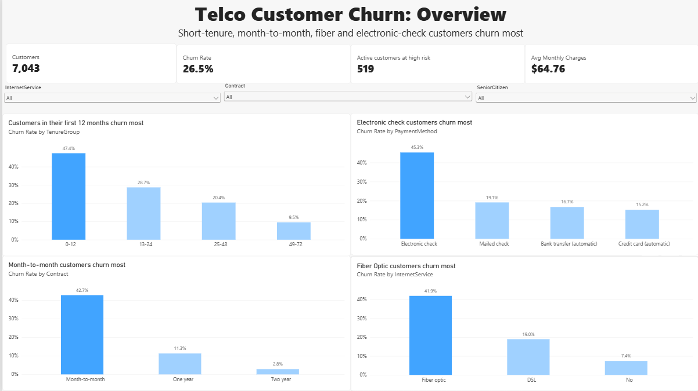
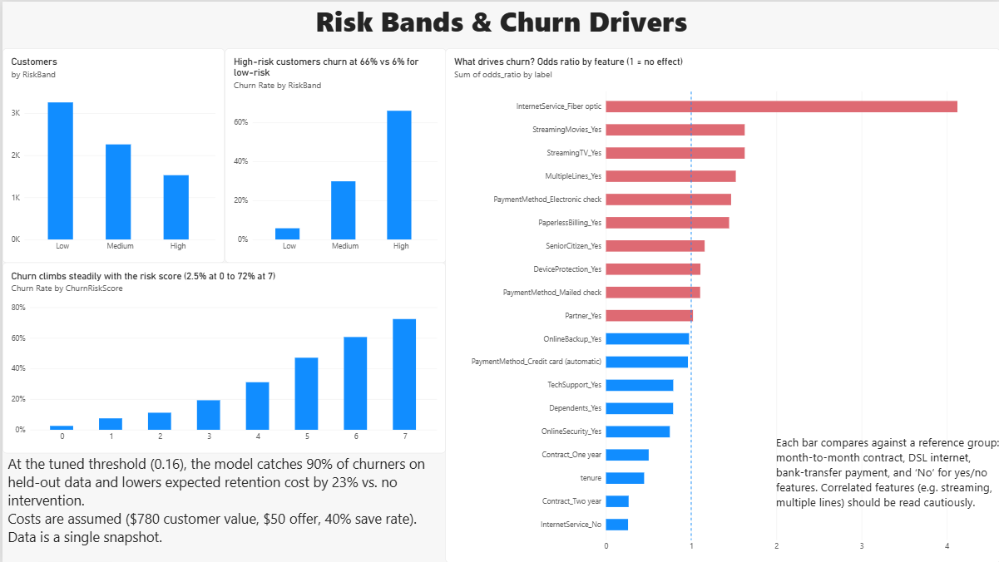

# Telco Customer Churn: Analysis, Prediction & Dashboard

An end-to-end data science project that identifies **why telecom customers leave** and **which active customers are most at risk**, so retention offers can be targeted before they churn. It covers data cleaning, exploratory analysis, statistical testing, a cost-aware machine learning model, and an interactive Power BI dashboard.

**Tools:** Python (pandas, NumPy, SciPy, scikit-learn, matplotlib, seaborn) · Google Colab · Power BI

---

## Headline results

| | Result |
|---|---|
| Data | 7,043 customers, 21 variables, 26.5% churn |
| Model | Logistic Regression in a scikit-learn Pipeline, ROC-AUC **0.84** (5-fold CV: 0.846 ± 0.013; held-out test: 0.839) |
| Tuned threshold | Using an assumed cost model, the decision threshold was moved from 0.50 to **0.16**, lifting recall on held-out data from **56% to 90%** |
| Business impact (assumed costs) | Expected retention cost **23% lower** than doing nothing ($224,376 vs $291,720 on the test set) |
| Risk bands | Churn rate is **5.7%** in the Low band vs **66.0%** in the High band |
| Strongest drivers | Contract type, internet service type, tenure, payment method |

> The cost figures use **assumed** values ($780 customer value, $50 retention offer, 40% save rate), not real company data. See [Limitations](#limitations).

---

## Dashboard




The Power BI dashboard has two pages:

1. **Churn Overview:** KPI cards and churn rate by tenure group, payment method, contract and internet service, with slicers for contract, internet service and senior citizen status.
2. **Risk Bands & Drivers:** model-based risk bands, churn rate by risk score, and the model's odds ratios for each feature.

The files are in [`dashboard/`](dashboard/): the `.pbix` and a PDF export.

---

## Business question

A telecom company loses revenue when customers leave, and keeping a customer is usually cheaper than winning a new one. This project asks:

1. **What factors are associated with churn?**
2. **Can we flag customers at risk early enough to act, and what decision threshold makes financial sense?**

---

## Dataset

The IBM *Telco Customer Churn* sample dataset (available on Kaggle): 7,043 customers and 21 columns covering demographics, account information, subscribed services and whether the customer churned (`Churn`, 26.5% Yes).

The raw file is not included in this repository. Download it from Kaggle and place it in `data/`.

---

## Method

### 1. Data cleaning
- `TotalCharges` was stored as text. It contained 11 blank values, all for customers with `tenure = 0` who had not yet been billed. They were filled with **0**, which matches what the blank means. Filling with the mean would have invented charges.
- `SeniorCitizen` (0/1) was recoded to Yes/No for consistency with the other binary fields.
- "No internet service" (1,526 customers) and "No phone service" (682 customers) were perfectly redundant with `InternetService` and `PhoneService`. They were merged into "No" to avoid duplicated information and multicollinearity.
- Checked for duplicate rows and confirmed that `customerID` is unique.

### 2. Exploratory analysis
Churn rates were compared across segments using **percentages, not counts**:

| Segment | Churn rate |
|---|---|
| Month-to-month contract | 42.7% |
| One-year contract | 11.3% |
| Two-year contract | 2.8% |
| Tenure 0-12 months | 47.4% |
| Tenure 49-72 months | 9.5% |
| Fiber optic internet | 41.9% |
| DSL internet | 19.0% |
| Electronic check payment | 45.3% |
| Automatic payment (card or bank) | 15.2% to 16.7% |
| Internet customers without tech support | 41.6% |
| Internet customers with tech support | 15.2% |

Churned customers had a median tenure of 10 months (vs 38 for retained customers) and a higher median monthly charge ($79.65 vs $64.43).

### 3. Feature engineering
- `Churn_binary` (target), `TenureGroup`, and `NumAddons` (count of add-on services)
- **`ChurnRiskScore`:** a points-based score (0-7) built from the contract, tenure, payment method, internet type and tech-support patterns found in EDA. Observed churn rises steadily from **2.5% at score 0 to 72.3% at score 7**. This score is *exploratory*: the rules were chosen after looking at the full dataset, so it describes churn but is not an independent test of predictive power. It was **excluded** from the model.

### 4. Statistical analysis
Chi-square tests for categorical features, with **Cramér's V** for effect size, and Mann-Whitney U tests for numeric features. With 7,043 rows almost everything is statistically significant, so features were ranked by effect size:

| Strength | Features (Cramér's V) |
|---|---|
| Strong | Contract (0.41), InternetService (0.32), PaymentMethod (0.30) |
| Moderate | PaperlessBilling (0.19), OnlineSecurity (0.17), TechSupport (0.16), Dependents (0.16), SeniorCitizen (0.15), Partner (0.15) |
| Weak | OnlineBackup, DeviceProtection, StreamingTV, StreamingMovies (0.06 to 0.08), MultipleLines (0.04) |
| No association | PhoneService (V = 0.011, p = 0.34), gender (V = 0.008, p = 0.49) |

Tenure, MonthlyCharges and TotalCharges all differed significantly between churned and retained customers (Mann-Whitney p < 0.001).

### 5. Modelling
- **Split:** stratified 80/20 (5,634 train / 1,409 test, `random_state=42`), preserving the 26.5% churn ratio in both sets.
- **Preprocessing:** `ColumnTransformer` with `StandardScaler` for numeric features and `OneHotEncoder(drop='first')` for categorical features, inside a scikit-learn `Pipeline` so that scaling and encoding are learned from training data only (no leakage).
- **Features dropped:** `customerID`, `gender` and `PhoneService` (no association with churn), the derived columns, and `TotalCharges` (correlated 0.83 with tenure, no gain in cross-validation, and it distorted coefficients).
- **Model comparison (5-fold stratified CV on the training set):**

| Model | ROC-AUC | Recall | Precision | F1 |
|---|---|---|---|---|
| Logistic Regression (balanced) | 0.846 ± 0.013 | 0.801 | 0.518 | 0.629 |
| Random Forest | 0.843 ± 0.011 | 0.720 | 0.563 | 0.632 |
| Gradient Boosting | 0.838 ± 0.009 | 0.525 | 0.644 | 0.578 |

The three models are effectively tied on ROC-AUC, so **Logistic Regression** was selected: equal performance and fully interpretable.

### 6. Evaluation and threshold tuning
Accuracy alone is misleading here, because always predicting "No churn" already scores 73.5%. The model was evaluated with precision, recall, F1, ROC-AUC and a confusion matrix.

The default 0.5 cutoff is not necessarily right for the business. Using a cost model:

- value of a lost customer: $780 (about 12 months of average billing)
- retention offer: $50
- offer success rate: 40%

the cost-optimal threshold is `offer / (success × value) = 0.16`, which the cost search on out-of-fold training predictions also found. Performance on the **held-out test set**:

| | Threshold 0.50 | Threshold 0.16 |
|---|---|---|
| Recall (churners caught) | 55.9% | **90.1%** (337 of 374) |
| Precision | 65.9% | 44.6% |
| Missed churners | 165 | **37** |
| False alarms | 108 | 419 |
| Accuracy | 80.6% | 67.6% |

Accuracy falls on purpose: each extra false alarm costs about $50, while each additional churner caught is worth far more. Under the assumed costs, expected cost is **23.1% lower than doing nothing** on the test set.

### 7. Interpretation
Odds ratios from the final model (holding other features fixed):

| Feature | Odds ratio | Reading |
|---|---|---|
| Fiber optic (vs DSL) | 4.1 | About 4× the odds of churn |
| No internet service (vs DSL) | 0.26 | About 74% lower odds |
| Two-year contract (vs month-to-month) | 0.27 | About 73% lower odds |
| One-year contract (vs month-to-month) | 0.50 | About half the odds |
| Tenure (per +1 SD, about 25 months) | 0.45 | About 55% lower odds |
| Electronic check (vs bank transfer) | 1.47 | About 47% higher odds |
| Paperless billing | 1.45 | About 45% higher odds |
| Online security / tech support | 0.75 / 0.79 | About 21 to 25% lower odds |

Coefficients of correlated billing and service variables (MonthlyCharges, streaming, multiple lines) were unstable and are **not** interpreted individually.

### 8. Dashboard and risk bands
Out-of-fold predicted probabilities were produced for all 7,043 customers (each from a model that never saw that customer) and grouped into bands:

| Risk band | Customers | Actual churn rate |
|---|---|---|
| Low (probability up to 0.16) | 3,257 | 5.7% |
| Medium (0.16 to 0.50) | 2,259 | 29.8% |
| High (above 0.50) | 1,527 | 66.0% |

**519 active customers fall in the High band.** They have not churned yet but look like those who did, which makes them the natural first retention list.

---

## Key findings and suggested actions

These are associations in the data, not proven causes, so any action should be tested (for example with an A/B test).

- **Push longer contracts early.** Month-to-month customers churn at 42.7% vs 2.8% for two-year contracts.
- **Focus on the first 12 months.** Customers in their first year churn at 47.4%.
- **Review fiber optic pricing and service quality.** Fiber customers churn at more than double the DSL rate and are less likely to have security and support add-ons.
- **Move customers to automatic payment.** Electronic-check customers churn at 45.3% vs about 15% to 17% for automatic payers.
- **Bundle tech support and online security.** Customers with these add-ons churn less.

---

## Limitations

- **Costs are assumptions.** The $780 / $50 / 40% values are illustrative. The threshold and savings depend on them. The method (not the exact numbers) is the point.
- **Snapshot data.** Features and outcome come from one point in time. A production model would use features frozen at a date and outcomes observed afterwards.
- **Association, not causation.** Odds ratios describe patterns in the data.
- **The risk score is exploratory.** Its rules were chosen after viewing the full dataset.
- **No hyperparameter tuning.** Models were compared with sensible defaults. Since the models were tied on ROC-AUC, tuning is unlikely to change the conclusion much.
- **No geographic analysis.** The dataset has no location field.

## Possible next steps
- Hyperparameter tuning and probability calibration checks
- SHAP values for per-customer explanations
- Time-based validation if timestamped data becomes available
- A/B test of retention offers to measure the real save rate

---

## Repository structure

```
telco-churn-prediction/
├── README.md
├── notebooks/
│   └── telco_churn_analysis.ipynb
├── data/
│   └── telco_dashboard_data.csv      # processed data with predictions and risk bands
├── dashboard/
│   ├── telco_churn_dashboard.pbix
│   └── Telco_Customer_Churn_Report.pdf
├── images/
│   ├── dashboard_page1.png
│   └── dashboard_page2.png
└── requirements.txt
```

## How to run

1. Download the Telco Customer Churn CSV from Kaggle and place it in `data/`.
2. Install the dependencies:
   ```
   pip install pandas numpy scipy scikit-learn matplotlib seaborn jupyter
   ```
3. Open `notebooks/telco_churn_analysis.ipynb` in Jupyter or Google Colab, update the data path in the first cell, and run all cells.
4. Open the `.pbix` in Power BI Desktop (Windows), or view the PDF export.

